## Hi, I'm Varnika

**Full-stack developer · CS + Math @ Penn State ’28**

`make it work, make it right, make it yours.`

I build software for messy, real-world problems: farms, payroll, hospitals and city water lines.

### About Me

**Varnika** here, a CS + Math double major at Penn State (class of 2028) who learns by shipping.

I build full-stack, AI-powered tools for real-world problems, from real-time fall detection for hospital waiting rooms to an AI payroll agent, and I test them until the numbers hold up.

- Open to **Summer 2027 SWE internships** (full-stack · backend · AI/ML · quant-dev)
- Focus: real-time systems, AI agents, data & quant, systems programming
- Strategy analyst at the **Quantitative Finance Club** · undergrad researcher in financial economics
- Event planner at **Builder’s Collective** · **HackPSU** education team

### Things I've Shipped

| project | what it does | built at |
|:--|:--|:--|
| **[FireDrill AR](https://github.com/prakhar2000/FIreDrillAR)** | Turns a real room into a mixed-reality fire drill you can see, hear and feel (DataFeel haptics on your wrists) | **★ DataFeel track winner** · MOLTEN, LA Tech Week ’26 |
| **[Terrametric](https://github.com/vs-githjk/Terrametric)** | Live crop-stress scores, 14-day forecasts and which field to treat first | **★ 3 prizes** · Bitcamp 2026 |
| **[Nod](https://github.com/AnushaAgarwal27/Nod)** | Five AI agents that turn customer interviews into shipped features | **★ Top 5** · AWS AI Startup Challenge |
| **[RollPay](https://github.com/Devaj6190/hyphenatable)** | AI payroll assistant that catches bad hours before payday | Cal Hacks 13.0 |
| **[Blue Grid](https://blue-grid-kitchener.vercel.app)** | Predicts which city water pipes break next and plans the fixes | UC Berkeley AI Hackathon ’26 |
| **[Echo by Relay](https://github.com/anantp1910/EchoByRelay)** | From one sentence a doctor says, makes sure the patient gets their medicine | HackGT 13 |
| **[WatchCare-AI](https://github.com/anantp1910/WatchCare-AI)** | Real-time fall detection on existing hospital camera feeds | NexHacks @ CMU |

### Connect

### Tech Stack

 

### GitHub Stats

 

